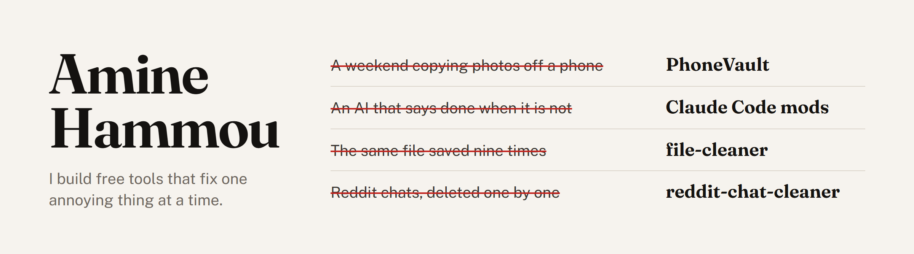

<a href="https://aminehammou.vercel.app">
  <picture>
    <source media="(max-width: 600px) and (prefers-color-scheme: dark)" srcset="assets/banner-dark-phone.png">
    <source media="(max-width: 600px)" srcset="assets/banner-light-phone.png">
    <source media="(prefers-color-scheme: dark)" srcset="assets/banner-dark.png">
    
  </picture>
</a>

**Free tools**

- [PhoneVault](https://github.com/zed-dz/phonevault): back up your Android phone to your own PC. No root, no cloud, undo any run.
- [Claude Code mods](https://github.com/zed-dz/claude-code-mods): small fixes for Claude Code itself.
- [file-cleaner](https://github.com/zed-dz/file-cleaner): get space back from duplicates, and put every file back if you change your mind.
- [reddit-chat-cleaner](https://github.com/zed-dz/reddit-chat-cleaner): delete your own Reddit chat messages all at once.

**Work for clients**

- [CBD Portal](https://portal.cbdpnl.com.au): timesheets, approvals and pay rules for a labour-hire company, and the same code at two more. [How it was built](https://aminehammou.vercel.app/work/workforce-portal.html)
- [Venture Command](https://venturecommand.com.au): one screen for a founder with a portfolio of companies. [How it was built](https://aminehammou.vercel.app/work/command-centre.html)
- [Uways](https://uwaisalqarni.com): a Quran school that ran on paper, now in Arabic on parents' phones. [How it was built](https://aminehammou.vercel.app/work/school-platform.html)

23 products shipped for six organisations in 2026. Need one? [Tell me what annoys you](https://aminehammou.vercel.app).
